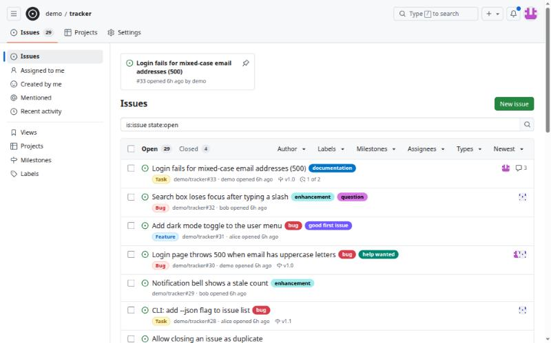
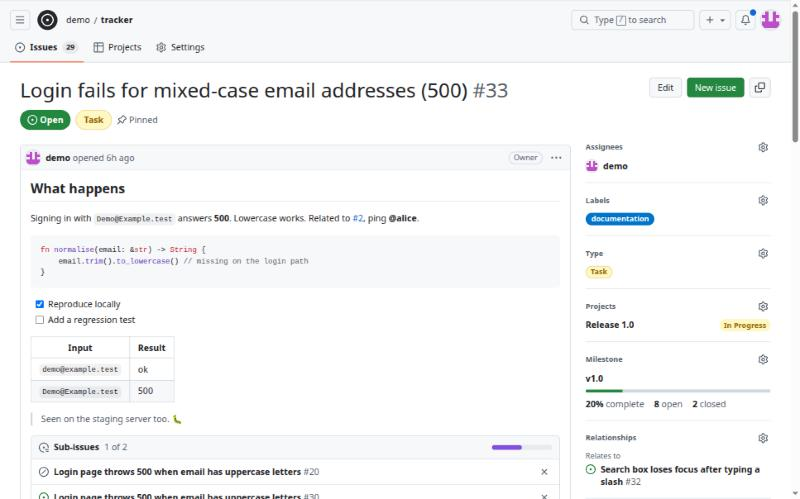
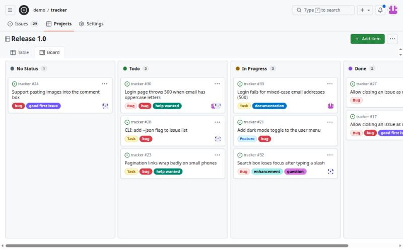

# Issue Tracker

A self-hosted issue tracker with the layout developers already know: issues, labels,
milestones, projects and notifications. The server is **one executable** with the web
interface built in, backed by MongoDB, and it comes with a command line tool, `it`.



| Issue | Project board |
|---|---|
|  |  |

## What it does

- **Issues**: markdown with task lists, code highlighting and file uploads; comments,
  reactions, edit history, `#12` cross-references and `@mentions`.
- **Organising**: labels, milestones, assignees, issue types, pinned issues, templates
  and bulk edits.
- **Relationships**: sub-issues with progress, plus "blocked by", "blocking" and
  "relates to" links.
- **Search**: a query box (`is:open label:bug author:@me sort:updated-desc`), filter
  menus, and saved views that are private or shared with the repository.
- **Projects**: a table and a drag-and-drop board over the same items, with your own fields.
- **Notifications**: an inbox, subscriptions, optional email, and pages that update
  live while you read them.
- **Access**: public and private repositories with four roles (read, triage, write,
  admin). A private repository looks like it does not exist to anyone without a role.
- **Everywhere**: works on a phone, follows light and dark mode.

## Quick start

You need Rust, Node.js 20 or newer with pnpm, and a MongoDB to connect to.

```bash
docker run -d --name it-mongo --restart unless-stopped --ulimit nofile=64000:64000 -p 127.0.0.1:27020:27017 mongo:7
```

```bash
./scripts/build-frontend.sh
```

```bash
cargo run -p issue-tracker
```

Open <http://127.0.0.1:23500> and sign up. **The first account becomes the site admin.**

To look around with data already in place, run `./scripts/seed-dev.sh` against a fresh
database. It creates three users (`demo`, `alice`, `bob`; the password is in the
script) and a repository full of issues.

## Running it for real

`./scripts/release.sh` builds two static Linux binaries into `dist/`:

| File | What |
|---|---|
| `dist/issue-tracker` | The server, web interface included. Copy it to a machine and run it. |
| `dist/it` | The command line tool. |

Settings come from environment variables; [`.env.example`](.env.example) lists them all.
The ones you will want to change:

| Variable | Why |
|---|---|
| `MONGODB_URI`, `MONGODB_DB` | Where the data lives. Uploads are stored in MongoDB too, so there is nothing else to back up. |
| `PUBLIC_URL` | The address people open; used for links in emails. |
| `COOKIE_SECURE` | Set to `true` behind HTTPS. |
| `ALLOW_SIGNUP` | Set to `false` once your team has accounts. |
| `SMTP_*` | Outgoing email. Leave `SMTP_HOST` empty and no email is sent. |

## The command line tool

```bash
it auth login --host https://issues.example.com
```

```bash
it issue list --label bug --assignee @me
it issue create --title "Login fails" --label bug
it issue view 12 --comments
it issue close 12 --reason "not planned"
it issue block 12 --by 9
```

Inside a project folder, a `.it.toml` file or the `IT_REPO` variable saves typing
`-R owner/name` every time. `it --help` and `it issue --help` list everything, and most
commands take `--json` for scripts. The tool signs in with a personal access token,
which you can also create under **Settings → Access tokens**.

## How it is built

| Path | What |
|---|---|
| `crates/server` | Actix Web server: the `/api` routes, access rules, markdown rendering, notifications. |
| `crates/cli` | The `it` tool. |
| `crates/shared` | Request and response types and the search query parser, used by both. |
| `frontend` | Next.js with Tailwind and shadcn, exported as static files and embedded in the server. |

A few choices worth knowing:

- Markdown is rendered and sanitized on the server; the browser only displays the result.
- Passwords are hashed with argon2. Session cookies and access tokens are stored as hashes only.
- Only real images are shown inline; every other upload is a download.

## Tests

```bash
cargo test
```

The tests run against the MongoDB above and clean up after themselves. Start the
container with the `--ulimit` shown in the quick start: with Docker's default limit
MongoDB runs out of file handles when the tests run twice in a row.

## What is not here

Organizations, avatar uploads, password reset by email and keyboard shortcuts.
[`PLAN.md`](PLAN.md) keeps the full list and the project's history (in Bangla).

## License

[MIT](LICENSE).
